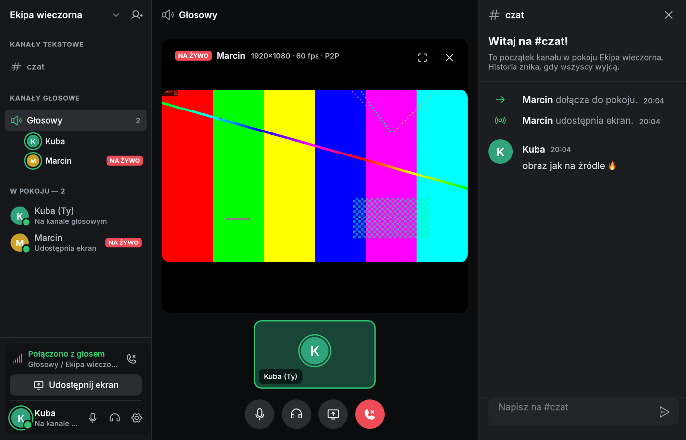
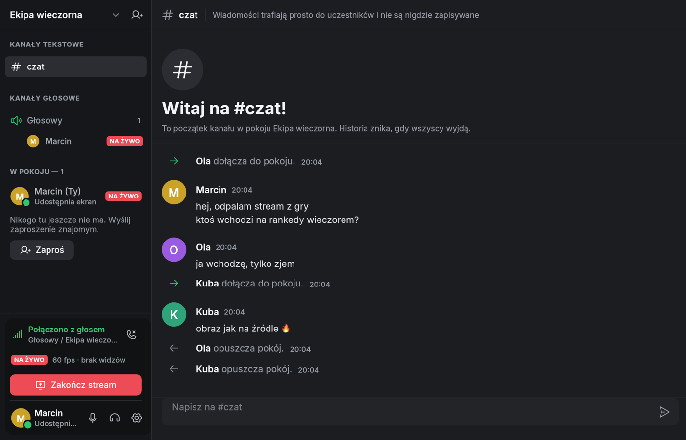
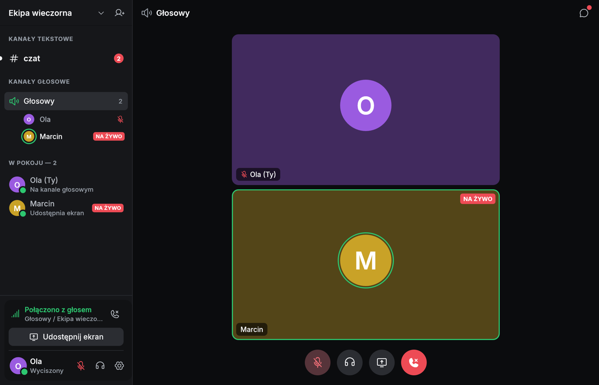
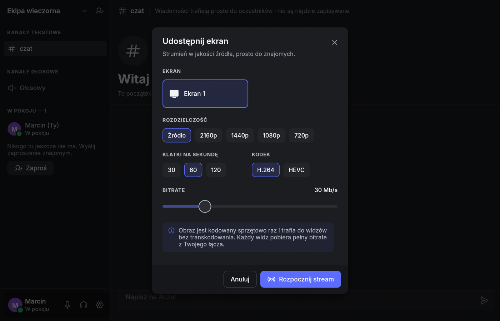

# BibiCord

Minimalistyczny „Discord” w Ruście, **bez serwera**: czat tekstowy, głos
i udostępnianie ekranu w jakości źródła. Działa na Windows 10, Windows 11
i macOS 14+.



## Interfejs

Ciemny, zwarty układ wzorowany na Discordzie: lista kanałów i uczestników po
lewej, czat albo scena głosowa w środku, panel połączenia i własny profil
(mikrofon, słuchawki, ustawienia) na dole paska.

* **Design system** – zasady w [`DESIGN.md`](DESIGN.md), tokeny w
  `src/ui/theme.rs` (kolory powierzchni, tekstu i stanów, skala typografii,
  odstępy w siatce 4 px, promienie, cienie, czas animacji 120 ms).
* **Typografia** – Inter (Regular/Medium/SemiBold/Bold) wbudowany w binarkę.
* **Ikony** – Phosphor (warianty regular i fill).
* **Komponenty** – `src/ui/widgets.rs`: przyciski, przyciski okrągłe, chipy,
  pola tekstowe, awatary z pierścieniem mówienia, odznaki NA ŻYWO, wiersze
  listy, menu, modale.
* **Ekrany** – start, czat (wiadomości grupowane), scena głosowa z kafelkami
  16:9, oglądanie streamu z paskiem uczestników i czatem obok, okna
  „Udostępnij ekran”, „Zaproś” i „Ustawienia głosu”.

| Czat | Kanał głosowy | Udostępnianie ekranu |
|---|---|---|
|  |  |  |

## Jak to działa

- **Sieć: P2P.** Każdy uczestnik łączy się z każdym bezpośrednio
  ([iroh](https://iroh.computer), QUIC, szyfrowanie end-to-end, przebijanie NAT).
  Nie ma własnego serwera. Publiczne relaye n0 służą tylko do zestawienia
  połączenia, a gdy bezpośrednie połączenie jest niemożliwe, przenoszą
  zaszyfrowany ruch. Przy każdej osobie widać, czy łączysz się `P2P`, czy przez `relay`.
- **Pokój = zaproszenie.** Tworzysz pokój, klikasz „zaproś”, a tekst
  zaproszenia wysyłasz znajomym. Kto dołączy, sam połączy się z pozostałymi.
- **Stream w jakości źródła.** Ekran jest przechwytywany natywnie
  (Windows: Desktop Duplication; macOS: ScreenCaptureKit), kodowany
  **sprzętowo jeden raz** (NVENC / AMF / QuickSync / Media Foundation /
  VideoToolbox) w natywnej rozdzielczości i FPS (do 120 fps, do 120 Mb/s).
  Zakodowany strumień trafia do widzów bajt w bajt, **bez transkodowania**.
  Dekodowanie u widza też jest sprzętowe.
  Nowy widz od razu dostaje ostatnią klatkę kluczową. Widz, któremu nie
  wystarcza łącze, jest przewijany do kolejnej klatki kluczowej, zamiast
  zbierać opóźnienie.
- **Głos.** Opus 48 kHz z FEC, wysyłany w datagramach QUIC (bez retransmisji),
  z buforem jitter i miksowaniem.

> Bez serwera każdy widz pobiera pełny bitrate od nadawcy. Przy 30 Mb/s
> i 3 widzach nadawca potrzebuje około 90 Mb/s wysyłania.

## Uruchomienie

```sh
cargo run --release
```

Wymagania do budowania: Rust (stable), CMake (dla Opusa), a na macOS
Xcode Command Line Tools. FFmpeg jest szukany obok pliku wykonywalnego,
w `PATH` albo (przy pierwszym uruchomieniu) pobierany automatycznie.
Można też podać własny: `BIBICORD_FFMPEG=/ścieżka/ffmpeg`.

Paczki:

- macOS: `scripts/bundle-macos.sh` tworzy `dist/BibiCord.app` z wbudowanym FFmpeg.
- Windows / macOS: workflow `.github/workflows/release.yml` buduje paczki zip
  (`BibiCord.exe` + `ffmpeg.exe`, `BibiCord.app`). Tag `v*` tworzy release.

Na macOS przy pierwszym streamie trzeba zezwolić na **Nagrywanie ekranu**,
a przy głosie na **Mikrofon** (Ustawienia systemowe → Prywatność i ochrona).

## Testy

```sh
cargo test                       # testy jednostkowe
cargo test -- --ignored          # end-to-end: 3 węzły przez prawdziwą sieć, czat + stream 1080p60
```

Zmienne pomocnicze: `BIBICORD_TEST_SOURCE=1` streamuje obraz testowy zamiast
ekranu, `BIBICORD_DEBUG=1` włącza szczegółowe logi, `BIBICORD_FAKE_AUDIO=1` uruchamia
głos bez urządzeń audio (`BIBICORD_FAKE_TONE=1` dodaje sygnał testowy).
Skryptowane uruchomienia do zrzutów ekranu opisuje nagłówek `src/demo.rs`.

## Struktura

| Plik | Rola |
|---|---|
| `src/net.rs` | pokój P2P (siatka połączeń iroh), czat, sygnalizacja, przesyłanie wideo i głosu |
| `src/proto.rs` | protokół i zaproszenia |
| `src/video/encode.rs` | przechwytywanie ekranu i wybór enkodera sprzętowego |
| `src/video/hub.rs` | rozsyłanie strumienia do widzów (klatki kluczowe, wolni widzowie) |
| `src/video/decode.rs` | dekodowanie sprzętowe do RGBA |
| `src/voice.rs` | mikrofon/głośniki, Opus, bufor jitter, wykrywanie mówienia |
| `src/ui/theme.rs` | tokeny design systemu i instalacja fontów |
| `src/ui/widgets.rs` | komponenty |
| `src/ui/{start,sidebar,chat,stage,dialogs}.rs` | ekrany i okna |
| `src/demo.rs` | skryptowane uruchomienia (testy, zrzuty ekranu) |

## Licencje

Font Inter: SIL Open Font License 1.1 (`assets/fonts/Inter-LICENSE.txt`).
Ikony Phosphor: MIT.

### FFmpeg

Pobierane/dołączane buildy FFmpeg są na licencji GPL. Przy dystrybucji
paczek z FFmpeg obowiązują jej warunki.
